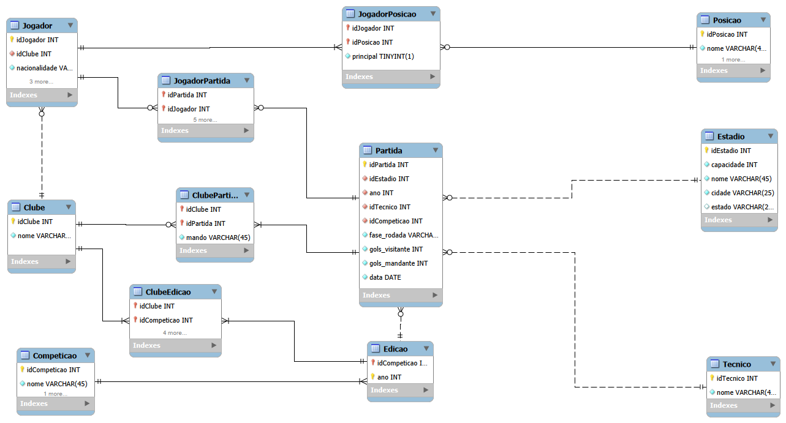

# Banco de Dados — Cruzeiro

Projeto em desenvolvimento, com o objetivo de criar um banco de dados relacional para armazenar e gerenciar informações sobre jogadores, partidas e competições disputadas pelo Cruzeiro Esporte Clube.

O projeto busca aplicar conhecimentos de modelagem de dados e SQL, com a proposta de evoluir futuramente para uma aplicação completa, utilizando Java no back-end e uma interface web no front-end.

### 🛠️ Tecnologias
- MySQL
- MySQL Workbench
- SQL

### 📊 Modelo lógico

